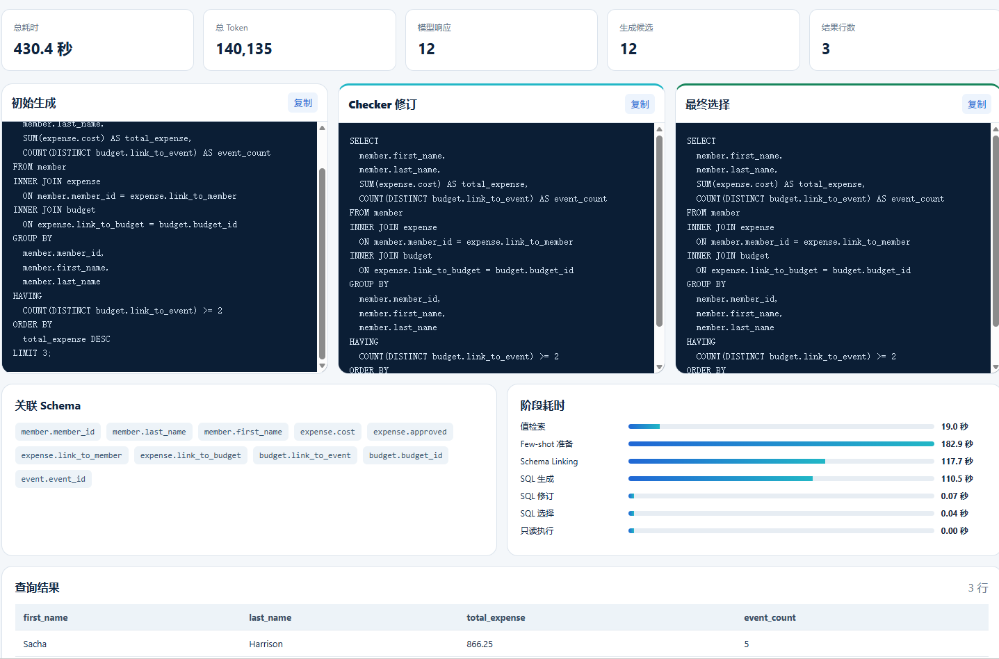
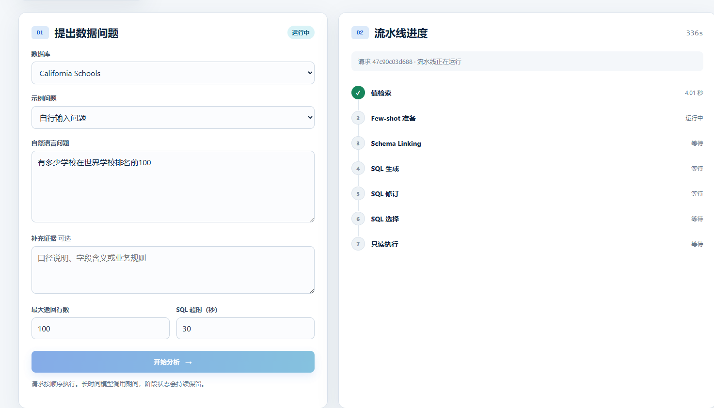

<div align="center">

# Text-to-SQL 引擎应用化改造（DeepEye-SQL 二次开发）

**六阶段流水线 + 只读安全执行 + SSE 实时进度 + 可复现三档消融评测**

[](./LICENSE)


🖥️ **本地演示项目**：不依赖云端部署，`python runner/run_demo.py` 起服务后浏览器直接看效果

</div>

> 自然语言问数系统：**FastAPI 演示层 + 七阶段 Text-to-SQL 流水线 + OpenAI 兼容推理端点 + 云端向量检索 + SQLite 只读执行沙箱**，把一个研究用流水线改造成可安全演示、可观测成本、可复现评测的应用。

---

## 📸 界面预览

| 结果页 · 三版 SQL 与阶段耗时 | 运行中 · 流水线进度与实时用量 |
|---|---|
|  |  |

> 📖 **答辩用一页纸说明**（三种启动方式、页面结构、故障排查、推荐演示问题）：[docs/demo-guide.md](./docs/demo-guide.md) · **交付范围界定**：[docs/internship-release-checklist.md](./docs/internship-release-checklist.md)

## 🧭 本仓库做了什么

本仓库以 [HKUSTDial/DeepEye-SQL](https://github.com/HKUSTDial/DeepEye-SQL)（*Proc. ACM Manag. Data* 2026，MIT）为 base 二次开发。**DC / Skeleton / ICL 生成策略、八个 Checker 判定逻辑、一致性过滤 + LLM 投票选择、渐进式 schema 裁剪等推理算法均沿用上游，未作修改**；下表只列本仓库的改动，逐提交可核对于 `git diff 252ab45..HEAD`。

| 改动 | 说明 | 位置 |
|---|---|---|
| 只读执行沙箱 | `mode=ro` 只能保护主库，挡不住 `ATTACH` 一个可写库。补 `PRAGMA query_only=ON` + `set_authorizer` 白名单（仅放行 SELECT/READ/FUNCTION/RECURSIVE 与元数据 PRAGMA），显式 DENY `load_extension`，并用 URI 规范化数据库路径 | `app/db_utils/execution.py`、`tests/test_sql_skill.py` |
| 嵌套线程池死锁修复 | dc/skeleton 子任务曾被提交到与 item 级相同的线程池，池被占满后子任务永久排队（现象：跑批 0 进度冻结）。改为当前线程顺序执行，并保留 item 级并行 | `app/few_shot/preliminary_sql.py` |
| 延迟与成本熔断 | 每请求 token / 墙钟硬上限（默认 120k / 600s）；当一次响应的全部候选都被 `max_tokens` 截断（思考模型典型失控形态）时抛 `TruncatedResponseError` 立即失败，不再在 tenacity × extractor 两层重试里循环小时级。实测同一失控请求由 **75 次调用** 收敛为 **1 次** | `app/llm/budget.py`、`app/llm/llm.py`、`app/llm_extractor/extractor.py` |
| 逐调用用量台账 | 基于 ContextVar 记录每次 LLM / embedding 调用的阶段、题目、耗时与 token，自定义 `ThreadPoolExecutor` 保证跨线程池传播；请求产物目录落 `usage.jsonl`，可精确回答"时间花在哪一阶段" | `app/llm/usage.py`、`app/vector_db/metered_embedding.py` |
| 单问题 Skill 封装 | 把批量评测脚本改造成一次请求一个 Skill 调用：独立产物目录、七阶段进度回调、异常统一收敛为 `failed_stage` + 本地 `error.txt`（密钥脱敏），对外响应不含原始 provider 报错 | `app/skills/sql_skill.py` |
| Web 演示站 | FastAPI + 原生单页（零构建）：串行任务队列、SSE 进度流、断线重连、按请求 ID 回放；展示三版 SQL、关联 Schema、阶段耗时条与结果表 | `app/demo/`、`runner/run_demo.py` |
| 重启不丢状态 | 任务状态落盘，进程重启后把上一次遗留的 `queued` / `running` 记录标记为 `interrupted` 并回放一条终结事件，避免前端对着已消失的请求 ID 无限等待 | `app/demo/task_manager.py` |
| 启动自检 | `--check-only` 输出数据库、值索引、few-shot 索引、离线报告的就绪状态 JSON，不泄漏任何凭据 | `app/demo/preflight.py` |
| 评测基础设施 | 固定种子分层抽样、三档消融报告（仅生成 / 生成＋修订 / 完整流程）、阶段实测计时、进度看板、基线报告与逐题明细落盘为可只读浏览的 `evals/` | `runner/report_ablation.py`、`runner/report_baseline.py`、`runner/select_bird_sample.py` |
| 配置分层 | 按模型组织模板；`demo-fast` 用低延迟档（采样预算 4→1、few-shot 7→5）与评测口径配置分离；本地实验配置与被忽略的密钥统一放在 `config/local/` | `config/template/`、`app/config/config.py` |

## ✨ 核心能力

| 能力 | 说明 |
|------|------|
| 🔍 值检索接地 | LLM 抽取关键词 → 向量检索库内真实值 → 把取值样例写回 schema，缓解"字段存在但值对不上" |
| 🧬 三路 SQL 生成 | Divide-and-Conquer、Skeleton、ICL 三种策略并行采样，产出多个候选 |
| 🛠️ Checker 修订 | 八个基于 SQL 错误模式的检查器（语法 / JOIN / ORDER BY+LIMIT / MIN-MAX / NULL / 时间 / SELECT / 结果空）逐个判定并修复 |
| 🗳️ 一致性选择 | 按执行结果分组统计一致性，超过阈值直接选定，否则交 LLM 两两比较投票 |
| 🔒 安全执行 | 只读连接 + authorizer 白名单 + SQL 超时 + 返回行数上限 + 每请求 token/时间熔断 |
| 📡 实时进度 | SSE 推送阶段起止与每次模型调用的累计用量；断线自动重连并回退到轮询 |
| 📊 可复现评测 | 固定种子抽样、三档消融、集合式与严格多重集双指标、逐题 SQL 与结果预览留档 |
| 🧾 成本可观测 | 阶段耗时条、token 归因、模型响应数、候选数在同一页面呈现，可定位瓶颈 |
| 🗄️ 多库白名单 | 五个 BIRD-dev 数据库白名单接入，每题独立产物目录，禁止越库访问 |

## 🏗️ 系统架构

```
浏览器（原生单页，零构建）
   │  POST /api/query                    ┌─────────────────────────────────┐
   ├─ 202 request_id ───────────────────►│ TaskManager  串行任务队列         │
   │  GET /api/query/{id}/events ◄─SSE───│  · 事件可回放（断线重连不丢进度） │
   │  GET /api/query/{id}                │  · 状态落盘，重启标记 interrupted │
   └─────────────────────────────────────└───────────────┬─────────────────┘
                                                         ▼
                            SQLSkill.run()   —— 七阶段串行，逐阶段回调进度
   ┌──────────────┬───────────────────┬──────────────┬────────────────┐
   │ value_       │ few_shot_         │ schema_      │ sql_generation │
   │ retrieval    │ preparation       │ linking      │ (DC/Skeleton/  │
   │ 关键词→真实值│ 初步SQL+掩码+检索 │ 正反向链接   │  ICL 三路采样) │
   └──────────────┴───────────────────┴──────────────┴────────┬───────┘
                                                    ┌──────────────────┐
                                                    │ sql_revision      │
                                                    │ sql_selection     │
                                                    │ execution（只读） │
                                                    └───────────────────┘
                                                         │
              每次模型/向量调用 → usage.jsonl（阶段、题目、耗时、token）
              每请求产物 → workspace/demo_requests/<request_id>/（快照 + result.json + error.txt）

外部依赖：OpenAI 兼容推理端点（自建，强制思考模型） · DashScope text-embedding-v4 · 本地 SQLite
```

## 🚀 快速开始

```bash
# 1. 安装依赖
uv sync                       # 或 pip install -e .

# 2. 准备配置（config/local/ 被 git 忽略，需自备模型服务地址与密钥）
#    模板见 config/template/<模型>/，本地实验配置放 config/local/<实验>/

# 3. 启动前自检：数据库、值索引、few-shot 索引、离线报告是否就绪
python runner/run_demo.py --check-only

# 4. 启动演示站
python runner/run_demo.py --config config/local/demo-fast/config-bird-demo.toml
#    等价：uvicorn app.demo.server:create_app_from_env --factory --port 8000

# 5. 打开 http://127.0.0.1:8000
```

**单题命令行入口**（不启服务，直接看 JSON 结果与产物目录）：

```bash
python runner/run_sql_skill.py --config <toml> --database <sqlite路径> \
  --database-id <白名单ID> --question "每个县分别有多少所学校？"
```

| 参数 | 默认 | 说明 |
|------|------|------|
| `--config` | `demo-fast` 档 | 决定模型服务、索引路径与采样预算 |
| `--host` | `127.0.0.1` | 仅本机；局域网投屏时显式 `--host 0.0.0.0` |
| `--port` | `8000` | 端口占用时换一个 |
| `DEMO_MAX_TOTAL_TOKENS` / `DEMO_MAX_SECONDS` | `120000` / `600` | 单请求熔断阈值，环境变量可临时放宽 |

> ⚠️ **启动前确认模型服务可达**：`curl <base_url>/models` 自检。演示站是**单进程串行队列**，同一时刻只处理一个请求，后提交的会排队。

## ⚠️ 能力边界（未实现与未解决的部分）

写在这里是为了避免被当成"什么都能做"的演示：

- **推理算法未改进**：生成、修订、选择三阶段的策略完全沿用上游，本仓库不宣称任何算法创新。
- **修订阶段当前测不出收益**：50 题三档消融中，仅生成与生成＋修订两档**完全同为 36/50**，Checker 修订造成 0 修复 / 0 退化。八个检查器都基于 SQL 正则错误模式（如 `ORDER BY` 内使用 `MIN/MAX`、`= (SELECT ... LIMIT n)`），演示实测中该阶段常以零次模型调用、0.07 秒通过，说明模式未命中生成的候选。这是已知薄弱环节，不能表述为"修订能力已验证"。
- **评测口径不等于 BIRD 官方榜单**：集合式 EX 用 `set(pred_rows) == set(gold_rows)` 判定，未实现官方对列序/列数的容忍规则；实测同一份上游预测在随机 200 题上为 64.3%，而官方 README 声称全量 dev 为 74.5%，差值无法用截断或列投影解释。跨口径比较无效。
- **准确率提升不显著**：完整流程 76.0% 对上游同题预测 72.0%，n=50 的 95% 置信区间约 ±12 个百分点，只能说"未退步"。
- **无多轮对话、无写操作、无结果修正**：一次提问一条 SQL，不能追问、不能让模型按反馈改 SQL。
- **单进程、无并发、无鉴权**：任务状态在内存（磁盘仅用于重启后标记中断），不支持多 worker 部署，也不适合公网暴露。
- **示例题单为英文**（BIRD 原题），交互语言为中文；中文超纲问题目前只有熔断兜底，没有"该库无法回答"的前置判定。
- **尾延迟受推理端点支配**：强制思考模型同一 prompt 实测 completion 为 435 / 1,726 / 8,192 token，端点不接受 `thinking_budget` 类参数（一律返回 500），无法从客户端约束思考长度。

## 🧪 验证与测试

| 检查项 | 结果 | 命令 / 位置 |
|---|---|---|
| 自动化单元测试 | **18 项通过**（离线，不触网） | `python -m unittest discover -s tests -q` |
| 只读执行安全性 | 写操作 / 多语句 / `ATTACH` / `load_extension` 全部被拒；递归查询超时被中断 | `tests/test_sql_skill.py` |
| 任务队列与重启 | 事件按序回放；遗留 `running` 记录被标记 `interrupted` 并可终结 SSE | `tests/test_demo.py` |
| 启动自检与凭据隔离 | 缺失索引能报就绪状态；对外响应与报告不含 API Key | `tests/test_demo.py` |
| 50 题三档消融 | 仅生成 72.0% / 生成＋修订 72.0% / 完整流程 **76.0%**，三组均 100% 可执行 | `evals/bird-dev-50/ablation/` |
| 上游同题对照 | 上游发布预测在同一 50 题子集 72.0%（本仓库口径复算） | `results/bird-dev/qwen3.6-27b.json` |
| 快速演示路径 | 3 题集合式与严格多重集**全部通过**，平均 41.62 秒 / 51,145 token 每题 | `evals/demo-fast/report.md` |
| 失控请求收敛 | 全候选被截断时 1 次调用即熔断（修复前 15 × 5 = 75 次） | `app/llm/llm.py` 截断判定 |

**尚未覆盖**：预算熔断与截断降级路径的自动化测试、前端渲染、真实模型端点的端到端回归。

## 📁 目录结构

```
DeepEye-SQL/
├── app/
│   ├── skills/               # 单问题 Skill：七阶段编排、只读执行、用量汇总
│   ├── demo/                 # 演示站：api / task_manager / registry / preflight / static
│   ├── llm/                  # LLM 封装 + 预算熔断(budget.py) + 用量台账(usage.py)
│   ├── pipeline/             # 六个阶段（上游算法 + 本仓库可观测性改造）
│   ├── few_shot/             # 动态少样本：掩码、索引、检索、初步 SQL
│   ├── vector_db/            # 值索引与 embedding 计量
│   ├── db_utils/             # 只读执行与 authorizer 沙箱
│   └── dataset/              # 数据项、阶段产物字段与校验
├── runner/                   # 命令行入口：演示站、单题、建索引、评测报告、抽样
├── config/
│   ├── template/             # 按模型组织的公开模板（含 demo-fast 低延迟档）
│   └── local/                # 本地实验配置与真实密钥（.gitignore 排除）
├── evals/                    # 题单、逐题明细与汇总报告（演示站只读浏览）
├── results/                  # 上游发布的预测文件（用于同题对照）
├── docs/                     # 运行手册、评测报告、失败分析、交付清单、截图
├── tests/                    # 18 项离线单元测试
└── workspace/                # 运行产物与索引（不入库）
```

> 数据集（3.2 GB）、模型权重、向量索引与运行产物均在 `.gitignore` 中排除；`data/` 需按 [docs/bird.md](./docs/bird.md) 自行下载。

## 📚 文档导航

| 文档 | 内容 | 适用 |
|------|------|------|
| [🖥️ 演示站说明](./docs/demo-guide.md) | 启动方式、页面结构、故障排查、推荐演示问题 | 所有人 |
| [📊 50 题三档消融](./docs/ablation-50.md) | 抽样方法、三组对照结果与阶段贡献 | 评测/面试 |
| [📉 失败案例分析](./docs/failure-analysis.md) | 五类典型错误的题号、现象与可行改进 | 开发 |
| [🧪 10 题工程基线](./docs/baseline-10.md) | 逐题耗时、token 与有效性说明 | 开发 |
| [🧩 单问题 Skill](./docs/sql-skill.md) | `SQLSkill` 输入输出、阶段产物、异常约定 | 开发者 |
| [🚀 BIRD 复现手册](./docs/bird.md) | 数据准备、索引构建、分阶段执行与导出 | 开发者 |
| [🕷️ Spider 运行手册](./docs/spider.md) | Spider test 的数据准备与分阶段执行 | 开发者 |
| [❄️ Spider2 运行手册](./docs/spider2.md) | Spider2-Lite / Snow 的云端执行与跳过值检索说明 | 开发者 |
| [📋 交付清单](./docs/internship-release-checklist.md) | 项目定位、已完成项与发布前检查 | 自己/面试官 |
| [📐 项目设计文档](./docs/项目设计文档.md) | 需求背景与整体设计 | 产品/架构 |

## ❓ 常见问题

**Q：一个问题为什么要跑好几分钟？**
延迟几乎全部来自思考模型的输出量。消融档单题实测 430 秒 / 140,135 token，其中约 11 万是思考 token；端点单流吞吐约 92 tok/s。演示请用 `demo-fast` 配置（采样预算 4→1），实测平均 41.62 秒。

**Q：界面上"Checker 修订"和"最终选择"内容一样？**
说明这次修订没有命中任何错误模式、选择走了一致性捷径（top-1 分数 ≥ 阈值即直接选定），两者都会是零模型调用、耗时接近 0。50 题消融中修订阶段的修复与退化均为 0，这是当前已知的薄弱环节。

**Q：报"预算熔断"是什么意思？**
该请求累计 token 或墙钟触到硬上限（默认 120k / 600s），通常是问题超出所选数据库可回答范围，或思考模型在某个候选上无限展开。可临时用 `DEMO_MAX_TOTAL_TOKENS` 放宽，但更该换问题或换库。

**Q：服务重启后旧请求查不到了？**
任务队列在内存，重启后旧请求会被标记为 `interrupted` 并给出说明，而不是让前端无限等待。历史产物仍在 `workspace/demo_requests/<request_id>/` 下可按请求 ID 翻查。

**Q：为什么日志里出现"empty final content"警告？**
思考模型把 `max_tokens` 全部花在推理上、没产出最终内容。现在这类响应会被判定为确定性失败并快速熔断，不再逐次重试；若只是部分候选为空，其余有效候选会被保留。

**Q：模型服务连不上 / 返回 500？**
先 `curl <base_url>/models` 确认服务在线。该端点对 `enable_thinking`、`thinking_budget` 等参数一律返回 500，只能在配置里不传这些参数。

**Q：能在公网部署吗？**
不建议。当前是单进程串行队列、无鉴权、任务状态在内存；且执行的是模型生成的 SQL，虽有只读沙箱与超时/行数上限，仍应在受控环境使用。

## 📄 开源协议与致谢

本仓库以 **[MIT](./LICENSE)** 分发，与上游项目保持一致。

| 范围 | 归属 |
|---|---|
| 六阶段 Text-to-SQL 流水线、DC/Skeleton/ICL 生成、Checker 修订、一致性选择、渐进式 schema 裁剪等核心算法 | © [HKUSTDial/DeepEye-SQL](https://github.com/HKUSTDial/DeepEye-SQL) 原作者（SIGMOD 2026） |
| 只读执行沙箱、线程池死锁修复、成本熔断与用量台账、单问题 Skill、Web 演示站与 SSE 进度、重启状态恢复、启动自检、三档消融评测体系、低延迟演示配置 | 本仓库维护者 |

论文：[DeepEye-SQL: A Software-Engineering-Inspired Text-to-SQL Framework](https://doi.org/10.1145/3802035), *Proc. ACM Manag. Data*, 4(3), Article 158, 2026.

```bibtex
@article{10.1145/3802035,
  author    = {Li, Boyan and Chen, Chong and Xue, Zhujun and Mei, Yinan and Luo, Yuyu},
  title     = {DeepEye-SQL: A Software-Engineering-Inspired Text-to-SQL Framework},
  year      = {2026},
  journal   = {Proc. ACM Manag. Data},
  volume    = {4},
  number    = {3},
  articleno = {158},
  doi       = {10.1145/3802035},
  url       = {https://doi.org/10.1145/3802035}
}
```

如果这个项目对你有帮助，欢迎点 ⭐ Star 或提 Issue 🙌

---

<div align="center">

**© 2026** · [MIT](./LICENSE) · 核心算法归属 [HKUSTDial/DeepEye-SQL](https://github.com/HKUSTDial/DeepEye-SQL) 原作者

</div>
